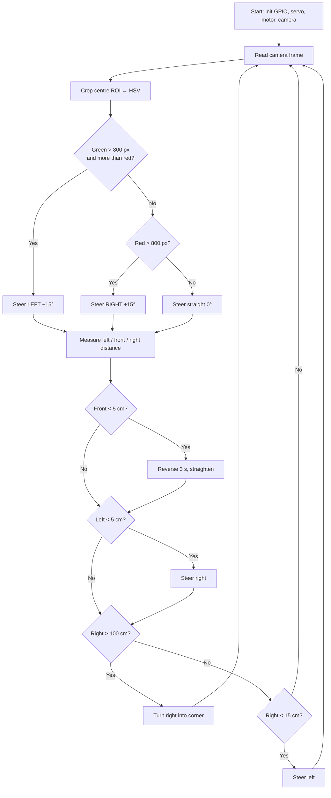

# 🤖 Autonomous Self-Driving Car — WRO 2025 Future Engineers

<!-- TODO (Shamil): add a cover photo of the robot here, e.g. -->
<!--  -->

An autonomous vehicle built for the **World Robot Olympiad (WRO) 2025 — Future Engineers** category,
presented at the **VIII Azerbaijan Robot Olympiad**.
The car drives laps around the field on its own, keeps a safe distance from the walls,
recognizes **red and green traffic pillars** with a camera and passes them on the correct side,
and counts the coloured lines on the mat to know how many laps it has completed.

> Built with Raspberry Pi, Python, OpenCV and a lot of late-night debugging.

---

## 📋 Table of Contents
- [The Challenge](#-the-challenge)
- [Hardware](#-hardware)
- [Wiring / Pinout](#-wiring--pinout)
- [Software Architecture](#-software-architecture)
- [How the Algorithm Works](#-how-the-algorithm-works)
- [Repository Structure](#-repository-structure)
- [Getting Started](#-getting-started)
- [Calibration](#-calibration)
- [Challenges & Lessons Learned](#-challenges--lessons-learned)
- [Future Improvements](#-future-improvements)
- [Team](#-team)
- [License](#-license)

---

## 🏁 The Challenge

In WRO Future Engineers the vehicle must complete laps on a rectangular track **fully autonomously**:

| Round | Task |
|-------|------|
| **Open Challenge** | Drive 3 laps without touching the walls. The inner wall position changes randomly. |
| **Obstacle Challenge** | Drive 3 laps while passing traffic pillars: **red → keep to the right**, **green → keep to the left**. |

The robot must use a car-like steering mechanism (steered front wheels, driven rear axle) — no differential/tank steering.

---

## 🔧 Hardware

| Component | Model | Purpose |
|-----------|-------|---------|
| Main controller | Raspberry Pi <!-- TODO: 4 or 5? --> | Runs the vision and control code |
| Camera | Raspberry Pi Camera Module <!-- TODO: version --> | Detects red/green pillars (160×120 @ 40 fps, MJPEG) |
| Drive motor | DC gear motor <!-- TODO: model / RPM --> | Rear-wheel drive |
| Motor driver | TB6612FNG | Direction + PWM speed control of the drive motor |
| Steering | Servo motor <!-- TODO: model (e.g. MG90S / SG90) --> | Front-wheel steering (±15° used) |
| Distance sensors | 3 × ultrasonic sensor <!-- TODO: HC-SR04? --> | Left / front / right wall distance |
| Colour sensor | TCS3200 / TCS230 | Detects the coloured lines on the mat → lap counting |
| Power | <!-- TODO: battery type, voltage, capacity --> | |
| Chassis | <!-- TODO: custom 3D-printed / LEGO / RC kit? --> | |

<!-- TODO (Shamil): add photos of the robot from all 6 sides into /v-photos -->

---

## 🔌 Wiring / Pinout

All pins use **BCM numbering**.

| Function | Signal | GPIO (BCM) |
|----------|--------|-----------|
| Steering servo | PWM (50 Hz) | **18** |
| Motor driver TB6612 | PWMA (100 Hz) | **13** |
| | AIN1 | **24** |
| | AIN2 | **25** |
| Ultrasonic — right | TRIG / ECHO | **21** / **20** |
| Ultrasonic — front | TRIG / ECHO | **27** / **17** |
| Ultrasonic — left | TRIG / ECHO | **4** / **23** |
| Colour sensor TCS3200 | S0 / S1 | **22** / **10** |
| | S2 / S3 | **9** / **11** |
| | OUT | **8** |

> ⚠️ The ultrasonic ECHO pins output 5 V while Raspberry Pi GPIO is 3.3 V — use a voltage divider or a level shifter.

The full wiring diagram is in [`/schemes`](schemes/).

---

## 💻 Software Architecture

```
src/
├── main.py                       # Main driving program: camera + ultrasonic sensors + steering + motor
└── lap_counter_color_sensor.py   # Lap counting with the TCS3200 colour sensor (blue line detection)
```

**Language:** Python 3  **Libraries:** OpenCV, NumPy, RPi.GPIO  **Camera stream:** `rpicam-vid` (MJPEG piped to OpenCV)

### `main.py` — driving and obstacle avoidance
1. **Camera stream.** `rpicam-vid` streams 160×120 MJPEG at 40 fps through a pipe; the program finds JPEG start/end markers (`FFD8` / `FFD9`) in the byte stream and decodes each frame with OpenCV. Low resolution keeps processing fast on the Pi.
2. **Region of interest.** Only the central third of the frame is analysed, which removes noise from the walls and the background.
3. **Colour segmentation (HSV).**
   - Green: H 35–85
   - Red: H 0–10 **and** 170–180 (red wraps around the hue circle, so two masks are combined)
   - A 5×5 morphological *opening* removes small noise blobs.
4. **Decision.** If more than 800 pixels of a colour are detected:
   - 🟢 **Green pillar** → steer **left** (−15°)
   - 🔴 **Red pillar** → steer **right** (+15°)
   - otherwise → drive straight (0°)
5. **Wall following with ultrasonic sensors.**
   - Front < 5 cm → reverse for 3 s and straighten the wheels
   - Left < 5 cm → steer right
   - Right > 100 cm (open corner) → turn right
   - Right < 15 cm → steer left, away from the wall
   - Invalid readings (timeout) return `-1` and are ignored.
6. **Debug view.** The detected direction and the ROI rectangle are drawn on the live camera window. Press `q` to quit.

### `lap_counter_color_sensor.py` — lap counting
- The TCS3200 outputs a square wave whose frequency depends on light intensity. Pins **S2/S3** select the red, green or blue photodiode filter, and **S0/S1** set the output scaling (100 % here).
- The program counts pulses in a 10 ms window for each filter, normalises them with calibration values to a 0–255 scale, and decides **BLUE** when blue dominates and is above 150.
- Every detection increments `blue_count`, which is used to count corners and therefore laps.

---

## 🧠 How the Algorithm Works



---

## 📁 Repository Structure

Follows the official WRO Future Engineers documentation template:

| Folder | Content |
|--------|---------|
| [`src/`](src/) | Source code |
| [`schemes/`](schemes/) | Wiring diagrams and electrical schematics |
| [`t-photos/`](t-photos/) | Team photos (one official + one fun) |
| [`v-photos/`](v-photos/) | Vehicle photos from all 6 sides |
| [`video/`](video/) | Link to the driving demonstration video |
| [`models/`](models/) | 3D models / CAD files of custom parts |
| [`other/`](other/) | Datasheets, notes, extra materials |

---

## 🚀 Getting Started

### Requirements
- Raspberry Pi with Raspberry Pi OS (Bookworm or newer, for `rpicam-vid`)
- Python 3.9+

### Install
```bash
git clone https://github.com/shamilmamedov340-ops/WRO-Future-Engineers-2025.git
cd WRO-Future-Engineers-2025
pip install -r requirements.txt
```
> On Raspberry Pi OS you can also install the libraries with `sudo apt install python3-opencv python3-numpy python3-rpi.gpio`.

### Run
```bash
# main driving program (camera window opens; press q to stop)
python3 src/main.py

# lap counter test with the colour sensor
python3 src/lap_counter_color_sensor.py
```

---

## 🎯 Calibration

**Camera (HSV thresholds)** — in `main.py`, adjust `lower_green/upper_green` and `lower_red1/2`, `upper_red1/2` under the competition lighting. The `800` pixel threshold controls how close a pillar must be before the robot reacts.

**Colour sensor** — in `lap_counter_color_sensor.py`:
1. Place the sensor over a **white** area of the mat.
2. Read the `Raw: R= G= B=` values printed in the console.
3. Write them into `RED_CALIBRATION`, `GREEN_CALIBRATION`, `BLUE_CALIBRATION`.

**Steering servo** — `set_angle()` converts an angle to a duty cycle (`(angle + 90) / 18 + 2`). If the wheels are not straight at 0°, adjust the offset.

---

## 🧗 Challenges & Lessons Learned
<!-- TODO (Shamil): write 3–5 real problems you faced and how you solved them. This is the most interesting part for readers and recruiters. Ideas: -->
- **Camera latency** — high resolution made the Pi too slow, so the stream was reduced to 160×120 MJPEG at 40 fps and only the central ROI is processed.
- **Detecting red** — red sits at both ends of the HSV hue range, so two masks had to be combined.
- **Noisy ultrasonic readings** — a 50 ms timeout returns `-1` for failed measurements, so the robot ignores bad data instead of reacting to it.
- **Colour sensor speed** — the sampling window was reduced from 100 ms to 10 ms per channel so the robot does not miss the line while moving.
<!-- - add your own: lighting at the venue, battery voltage drop, mechanical steering play, ... -->

---

## 🔭 Future Improvements
- Merge lap counting into `main.py` so the robot stops automatically after 3 laps.
- Replace fixed steering angles with a **PID controller** for smooth wall following.
- Avoid blocking `time.sleep()` calls in the control loop (e.g. in `set_angle()`) to react faster.
- Use pillar **position and size** in the frame (contours / centroid) instead of only pixel count.
- Run ultrasonic measurements in a separate thread to keep the camera loop fast.
- Add an IMU (gyroscope) for precise heading during turns.

---

## 👥 Team
<!-- TODO (Shamil): fill in names and roles -->
| Name | Role |
|------|------|
| **Shamil Mammadov** — [LinkedIn](https://www.linkedin.com/in/shamil-mammadov-419995326/) | <!-- e.g. software, computer vision, electronics --> |
| <!-- teammate --> | <!-- role --> |

Baku Engineering University — INHA University double degree program, Electrical & Electronics Engineering.

---

## 🎥 Demo
<!-- TODO (Shamil): paste the YouTube link here and in /video/README.md -->
[](https://youtube.com/)

---

## 📄 License
This project is licensed under the MIT License — see [LICENSE](LICENSE).
