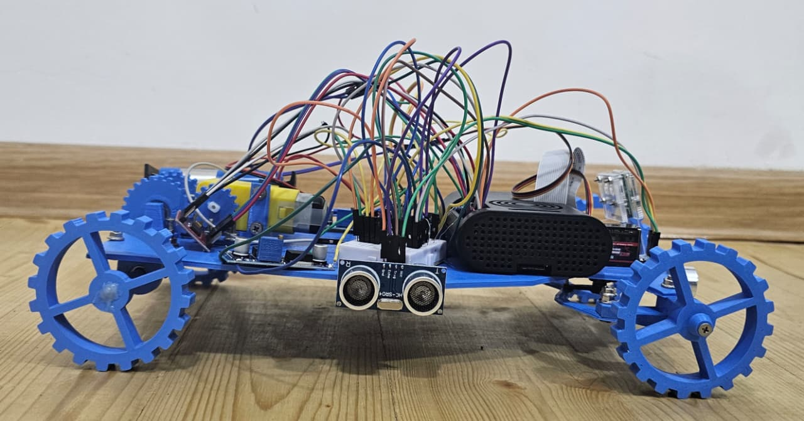
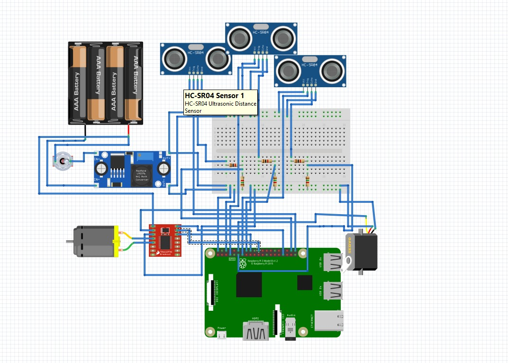
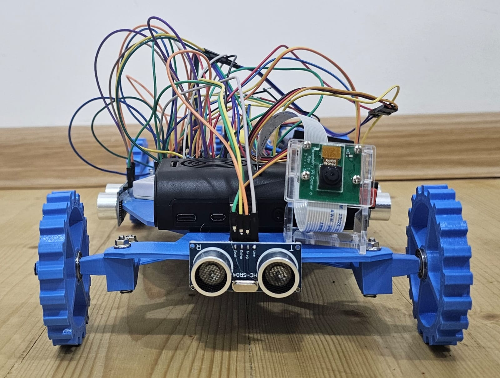
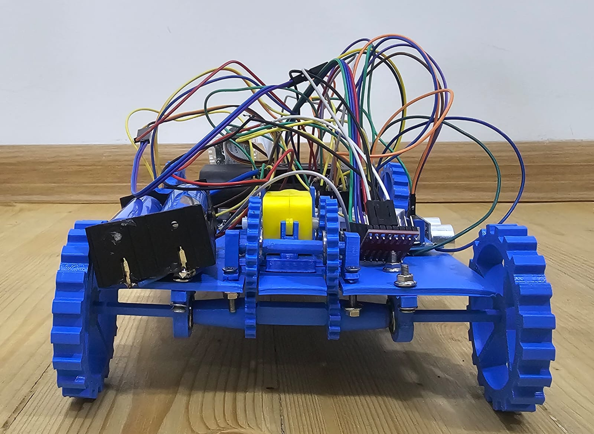
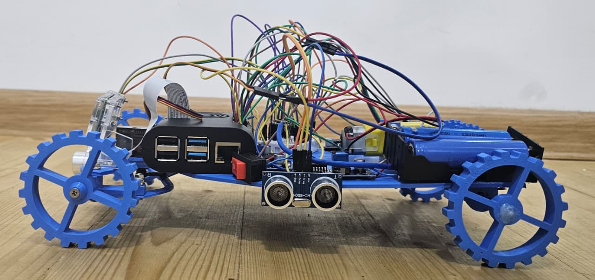
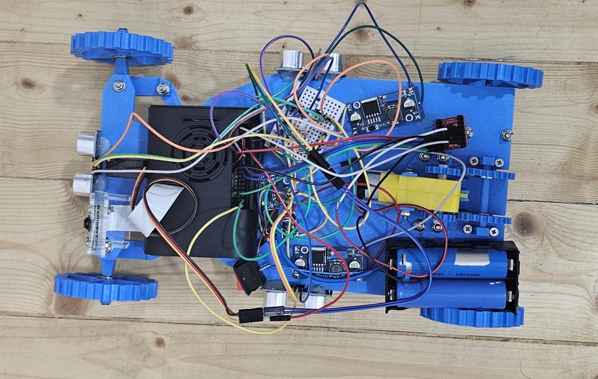
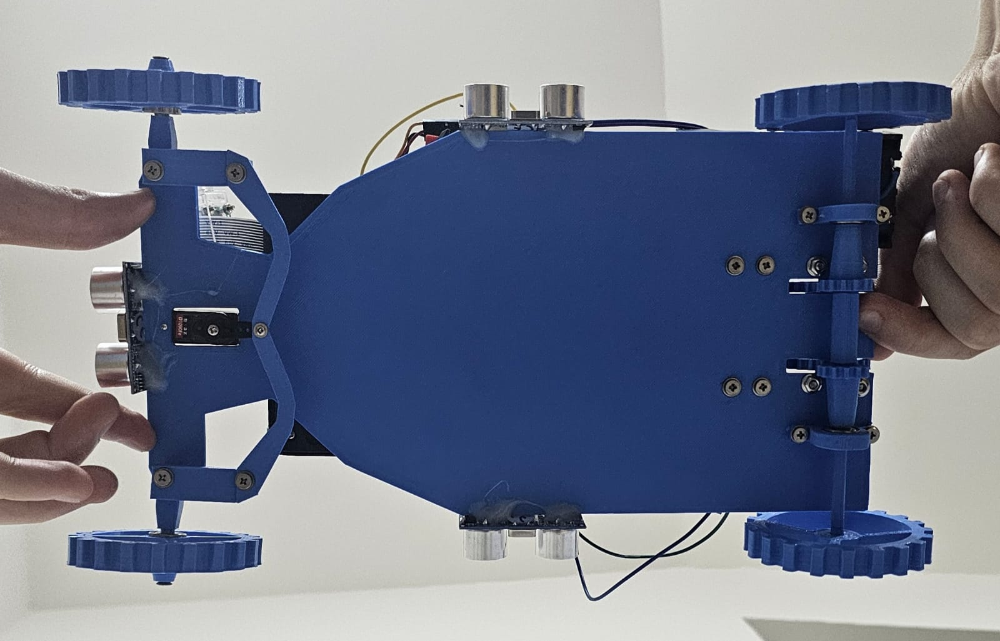
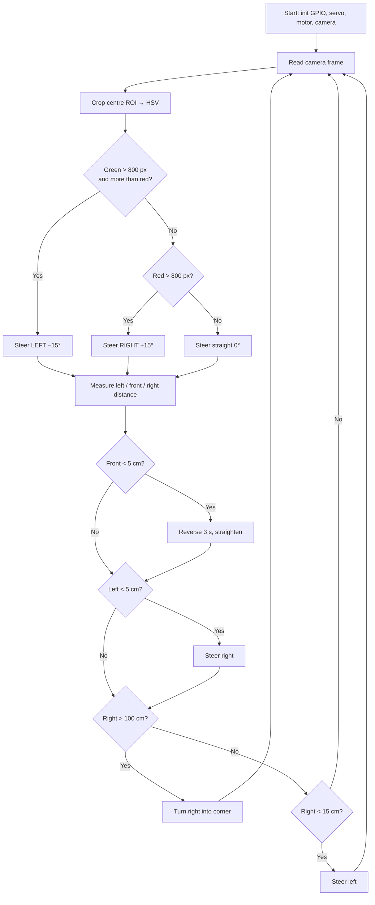
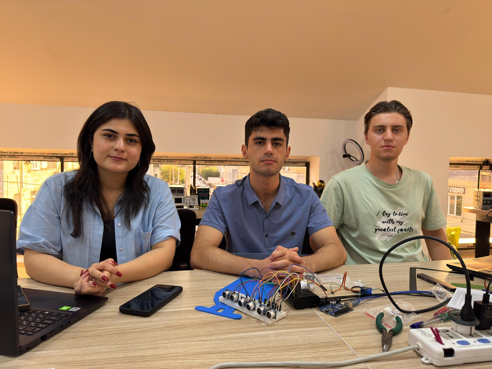

# 🤖 Autonomous Self-Driving Car — WRO 2025 Future Engineers

<p align="center"></p>

An autonomous vehicle built for the **World Robot Olympiad (WRO) 2025 — Future Engineers** category,
presented at the **VIII Azerbaijan Robot Olympiad**.
The car drives laps around the field on its own, keeps a safe distance from the walls,
recognizes **red and green traffic pillars** with a camera and passes them on the correct side,
and counts the coloured lines on the mat to know how many laps it has completed.

> Built with Raspberry Pi, Python, OpenCV, 3D-printed parts and a lot of late-night debugging.
> This was our team's **first WRO Future Engineers competition and our first project with a Raspberry Pi**.

---

## 📋 Table of Contents
- [The Challenge](#-the-challenge)
- [Hardware](#-hardware)
- [Wiring / Pinout](#-wiring--pinout)
- [Photos](#-photos)
- [Mechanical Design](#%EF%B8%8F-mechanical-design)
- [Software Architecture](#-software-architecture)
- [Development Process](#%EF%B8%8F-development-process)
- [How the Algorithm Works](#-how-the-algorithm-works)
- [Repository Structure](#-repository-structure)
- [Getting Started](#-getting-started)
- [Calibration](#-calibration)
- [Challenges & Lessons Learned](#-challenges--lessons-learned)
- [Future Improvements](#-future-improvements)
- [Team](#-team)
- [License](#-license)

---

## 🏁 The Challenge

In WRO Future Engineers the vehicle must complete laps on a rectangular track **fully autonomously**:

| Round | Task |
|-------|------|
| **Open Challenge** | Drive 3 laps without touching the walls. The inner wall position changes randomly. |
| **Obstacle Challenge** | Drive 3 laps while passing traffic pillars: **red → keep to the right**, **green → keep to the left**. |

The robot must use a car-like steering mechanism (steered front wheels, driven rear axle) — no differential/tank steering.

---

## 🔧 Hardware

| Component | Model | Purpose |
|-----------|-------|---------|
| Main controller | Raspberry Pi 4 Model B → replaced by **Raspberry Pi 3 Model B** | Runs the vision and control code (see [Challenges](#-challenges--lessons-learned) for why we switched) |
| Camera | Raspberry Pi Camera Module (CSI ribbon connector, plugs directly into the Pi) | Detects red/green pillars (160×120 @ 40 fps, MJPEG) |
| Drive motor | 1 × yellow TT DC gear motor <!-- TODO: check model / RPM --> | Drives the rear wheels through a gear train (rules allow only one drive motor) |
| Motor driver | TB6612FNG | Direction + PWM speed control of the drive motor |
| Steering | Servo motor <!-- TODO: model (e.g. MG90S / SG90) --> | Front-wheel steering (±15° used) |
| Distance sensors | 3 × HC-SR04 ultrasonic sensor (with resistor voltage dividers on the ECHO lines) | Left / front / right wall distance |
| Colour sensor | TCS3200 / TCS230 | Detects the coloured lines on the mat → lap counting |
| Power | Battery pack <!-- TODO: battery type, voltage, capacity --> + **3 × LM2596 buck converters** | Regulator 1 → Raspberry Pi, regulator 2 → motor driver, regulator 3 → ultrasonic sensors and other modules. Separate rails keep motor noise away from the Pi |
| Chassis & body | 3D-printed parts (open design found on YouTube, printed by the team) | Frame, gear train, sensor and camera mounts |
| Prototyping | Breadboard + jumper wires | Power distribution and voltage dividers |

**Dimensions:** about **13.6 cm × 26 cm** (width × length), see the [layout sketch](schemes/layout-sketch.jpg).


---

## 🔌 Wiring / Pinout

All pins use **BCM numbering**.

| Function | Signal | GPIO (BCM) |
|----------|--------|-----------|
| Steering servo | PWM (50 Hz) | **18** |
| Motor driver TB6612 | PWMA (100 Hz) | **13** |
| | AIN1 | **24** |
| | AIN2 | **25** |
| Ultrasonic — right | TRIG / ECHO | **21** / **20** |
| Ultrasonic — front | TRIG / ECHO | **27** / **17** |
| Ultrasonic — left | TRIG / ECHO | **4** / **23** |
| Colour sensor TCS3200 | S0 / S1 | **22** / **10** |
| | S2 / S3 | **9** / **11** |
| | OUT | **8** |

> ⚠️ The ultrasonic ECHO pins output 5 V while Raspberry Pi GPIO is 3.3 V — use a voltage divider or a level shifter.

### Wiring diagram
<p align="center"></p>

More planning material is in [`/schemes`](schemes/): the hand-drawn [component layout](schemes/layout-sketch.jpg) and our [pin-planning whiteboard](schemes/pin-planning-whiteboard.jpg).

---

## 📸 Photos

| Front | Back |
|:---:|:---:|
|  |  |
| **Left** | **Right** |
|  |  |
| **Top** | **Bottom** |
|  |  |

---

## ⚙️ Mechanical Design

- **Chassis and body** are 3D-printed. We based them on an open design we found on YouTube, then printed and assembled all parts ourselves.
- **One drive motor.** The rules allow only a single drive motor, so we built a **gear train with a drive shaft** that transfers torque from the motor to the rear wheels.
- **Steering** is done by a servo turning the front wheels, like a real car (Ackermann-style).
- **Gear fixes.** The printed gears slipped and did not seat properly on their shafts. We filed the gears to increase the contact area and friction, and glued the joints in critical places to make the drivetrain rigid.

<!-- TODO (Shamil, optional): add a close-up photo of the gear train, e.g.  -->

---

## 💻 Software Architecture

```
src/
├── main.py                       # Main driving program: camera + ultrasonic sensors + steering + motor
└── lap_counter_color_sensor.py   # Lap counting with the TCS3200 colour sensor (blue line detection)
```

**Language:** Python 3  **Libraries:** OpenCV, NumPy, RPi.GPIO  **Camera stream:** `rpicam-vid` (MJPEG piped to OpenCV)

### `main.py` — driving and obstacle avoidance
1. **Camera stream.** `rpicam-vid` streams 160×120 MJPEG at 40 fps through a pipe; the program finds JPEG start/end markers (`FFD8` / `FFD9`) in the byte stream and decodes each frame with OpenCV. Low resolution keeps processing fast on the Pi.
2. **Region of interest.** Only the central third of the frame is analysed, which removes noise from the walls and the background.
3. **Colour segmentation (HSV).**
   - Green: H 35–85
   - Red: H 0–10 **and** 170–180 (red wraps around the hue circle, so two masks are combined)
   - A 5×5 morphological *opening* removes small noise blobs.
4. **Decision.** If more than 800 pixels of a colour are detected:
   - 🟢 **Green pillar** → steer **left** (−15°)
   - 🔴 **Red pillar** → steer **right** (+15°)
   - otherwise → drive straight (0°)
5. **Wall following with ultrasonic sensors.**
   - Front < 5 cm → reverse for 3 s and straighten the wheels
   - Left < 5 cm → steer right
   - Right > 100 cm (open corner) → turn right
   - Right < 15 cm → steer left, away from the wall
   - Invalid readings (timeout) return `-1` and are ignored.
6. **Debug view.** The detected direction and the ROI rectangle are drawn on the live camera window. Press `q` to quit.

### `lap_counter_color_sensor.py` — lap counting
- The TCS3200 outputs a square wave whose frequency depends on light intensity. Pins **S2/S3** select the red, green or blue photodiode filter, and **S0/S1** set the output scaling (100 % here).
- The program counts pulses in a 10 ms window for each filter, normalises them with calibration values to a 0–255 scale, and decides **BLUE** when blue dominates and is above 150.
- Every detection increments `blue_count`, which is used to count corners and therefore laps.

---

## 🛠️ Development Process

1. **Module by module.** We wrote and tested the code for each subsystem separately: the camera colour detection, the ultrasonic sensors, the steering servo, the drive motor and the colour sensor.
2. **Integration.** After every part worked on its own, we merged them step by step into one program.
3. **Tools.** Development was done directly on the Raspberry Pi in **Thonny** on Raspberry Pi OS. The final program was long, so we brought it onto the Pi and assembled it in Thonny piece by piece.
4. **Headless setup (no monitor).** We had no monitor for the Pi, so we worked with it remotely:
   - opened a **Wi-Fi hotspot on the laptop** and configured the Raspberry Pi to connect to it automatically;
   - found the Pi's **IP address** in the hotspot's list of connected devices;
   - connected over **SSH with PuTTY** and enabled VNC on the Pi (`sudo raspi-config` → Interface Options → VNC);
   - opened **RealVNC Viewer** on the laptop, connected to the Pi's IP and worked with its full desktop, including Thonny.

```
Laptop (Wi-Fi hotspot) ──Wi-Fi──► Raspberry Pi
      │                               ▲
      ├── PuTTY (SSH) ───────────────┤  enable VNC
      └── RealVNC Viewer ────────────┘  remote desktop → Thonny
```

---

## 🧠 How the Algorithm Works



---

## 📁 Repository Structure

Follows the official WRO Future Engineers documentation template:

| Folder | Content |
|--------|---------|
| [`src/`](src/) | Source code |
| [`schemes/`](schemes/) | Wiring diagrams and electrical schematics |
| [`t-photos/`](t-photos/) | Team photos (one official + one fun) |
| [`v-photos/`](v-photos/) | Vehicle photos from all 6 sides |
| [`video/`](video/) | Link to the driving demonstration video |
| [`models/`](models/) | 3D models / CAD files of custom parts |
| [`other/`](other/) | Datasheets, notes, extra materials |

---

## 🚀 Getting Started

### Requirements
- Raspberry Pi 4B or 3B with Raspberry Pi OS (Bookworm or newer, for `rpicam-vid`)
- Raspberry Pi camera connected to the CSI port
- We used **Thonny** (pre-installed on Raspberry Pi OS) to write and run the code
- No monitor needed: connect via SSH (PuTTY) + VNC (RealVNC Viewer) over a laptop hotspot — see [Development Process](#%EF%B8%8F-development-process)
- Python 3.9+

### Install
```bash
git clone https://github.com/shamilmamedov340-ops/WRO-Future-Engineers-2025.git
cd WRO-Future-Engineers-2025
pip install -r requirements.txt
```
> On Raspberry Pi OS you can also install the libraries with `sudo apt install python3-opencv python3-numpy python3-rpi.gpio`.

### Run
```bash
# main driving program (camera window opens; press q to stop)
python3 src/main.py

# lap counter test with the colour sensor
python3 src/lap_counter_color_sensor.py
```

---

## 🎯 Calibration

**Camera (HSV thresholds)** — in `main.py`, adjust `lower_green/upper_green` and `lower_red1/2`, `upper_red1/2` under the competition lighting. The `800` pixel threshold controls how close a pillar must be before the robot reacts.

**Colour sensor** — in `lap_counter_color_sensor.py`:
1. Place the sensor over a **white** area of the mat.
2. Read the `Raw: R= G= B=` values printed in the console.
3. Write them into `RED_CALIBRATION`, `GREEN_CALIBRATION`, `BLUE_CALIBRATION`.

**Steering servo** — `set_angle()` converts an angle to a duty cycle (`(angle + 90) / 18 + 2`). If the wheels are not straight at 0°, adjust the offset.

---

## 🧗 Challenges & Lessons Learned
### Hardware
- **Burned Raspberry Pi 4B.** During testing our Raspberry Pi 4B stopped giving 3.3 V on its GPIO pins. We later found the cause: we had not accounted for **current flowing back into the Pi** from the motor/power side, and it damaged the board's protection circuit. We switched to a **Raspberry Pi 3B** to continue.
  *Lesson:* isolate the motor power from the logic power, use protection diodes against back-current, and check the wiring with a multimeter before powering on.
- **Slipping gears.** The 3D-printed gears slipped or did not seat on the shafts. We filed them to increase the contact surface and friction and glued the weakest joints.
- **No spare parts.** As it was our first competition of this kind, we printed only one set of parts. When a part broke, it caused big delays.
  *Lesson:* always print spare gears, mounts and other wear parts before the competition.

### Software
- **Camera latency** — high resolution made the Pi too slow, so the stream was reduced to 160×120 MJPEG at 40 fps and only the central ROI is processed.
- **Detecting red** — red sits at both ends of the HSV hue range, so two masks had to be combined.
- **Noisy ultrasonic readings** — a 50 ms timeout returns `-1` for failed measurements, so the robot ignores bad data instead of reacting to it.
- **Colour sensor speed** — the sampling window was reduced from 100 ms to 10 ms per channel so the robot does not miss the line while moving.

---

## 🔭 Future Improvements
- Merge lap counting into `main.py` so the robot stops automatically after 3 laps.
- Replace fixed steering angles with a **PID controller** for smooth wall following.
- Avoid blocking `time.sleep()` calls in the control loop (e.g. in `set_angle()`) to react faster.
- Use pillar **position and size** in the frame (contours / centroid) instead of only pixel count.
- Run ultrasonic measurements in a separate thread to keep the camera loop fast.
- Add an IMU (gyroscope) for precise heading during turns.

---

## 👥 Team
| Name | Role |
|------|------|
| **Shamil Mammadov** — [LinkedIn](https://www.linkedin.com/in/shamil-mammadov-419995326/) | **Software lead.** Wrote almost all of the code, set up the Raspberry Pi, integrated all modules into one program, and taught teammates how the software and connections work. Also helped build the robot and wired and tested sensors. |
| **Hakim Musazada** - [LinkedIn](https://www.linkedin.com/in/hakim-musazada/)  | **Hardware & design.** Mechanical design, assembly and wiring of the robot. |
| **Chichak Abdullayeva** - [LinkedIn](https://www.linkedin.com/in/chichak-abdullayeva/) | **Software support.** Helped with the software and with testing. |

Baku Engineering University — INHA University double degree program, Electrical & Electronics Engineering.

<p align="center"></p>

---

## 🎥 Demo
Test runs of the robot on the practice track:

- ▶️ [Test run 1](video/test-run-1.mp4) (34 s)
- ▶️ [Test run 2](video/test-run-2.mp4) (12 s)

<!-- TODO (Shamil, optional): upload the videos to YouTube as well and add the links here; YouTube videos play right inside GitHub's page preview -->

---

## 📄 License
This project is licensed under the MIT License — see [LICENSE](LICENSE).
