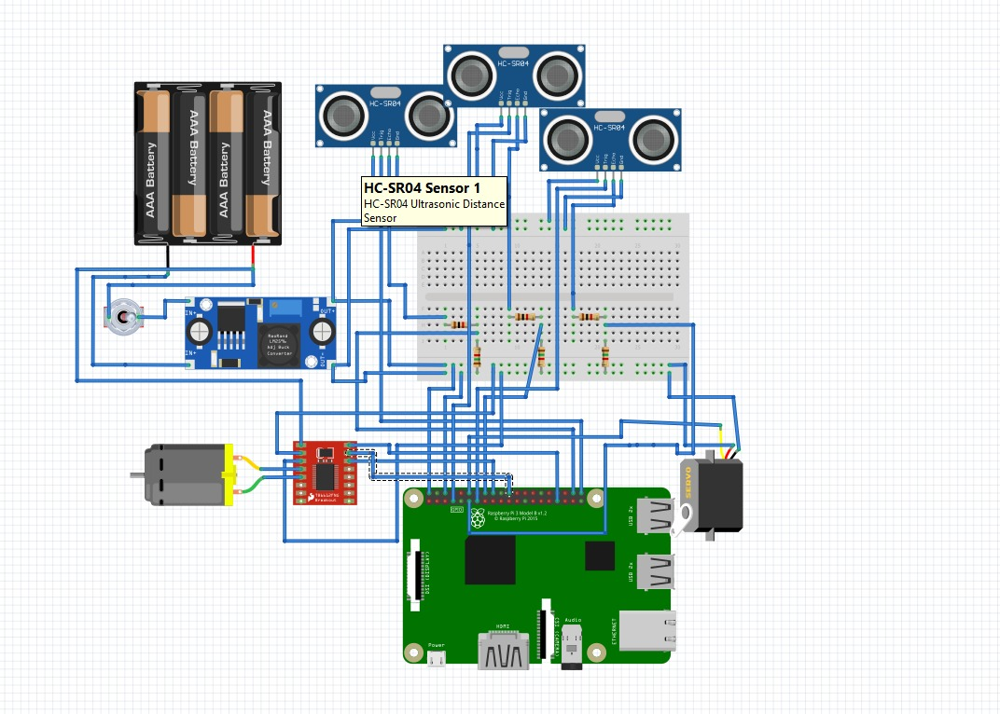

# Wiring diagrams

| File | Description |
|------|-------------|
| `wiring-diagram.jpg` | Full wiring diagram: Raspberry Pi, TB6612FNG, servo, 3 × HC-SR04 with voltage dividers, LM2596 buck converter, battery |
| `layout-sketch.jpg` | Hand-drawn component layout on the chassis (13.6 × 26 cm) and power distribution plan |
| `pin-planning-whiteboard.jpg` | GPIO pin planning on the whiteboard |

## Pin table

| Function | Signal | GPIO (BCM) |
|----------|--------|-----------|
| Steering servo | PWM | 18 |
| TB6612 motor driver | PWMA / AIN1 / AIN2 | 13 / 24 / 25 |
| Ultrasonic right | TRIG / ECHO | 21 / 20 |
| Ultrasonic front | TRIG / ECHO | 27 / 17 |
| Ultrasonic left | TRIG / ECHO | 4 / 23 |
| TCS3200 colour sensor | S0 / S1 / S2 / S3 / OUT | 22 / 10 / 9 / 11 / 8 |
