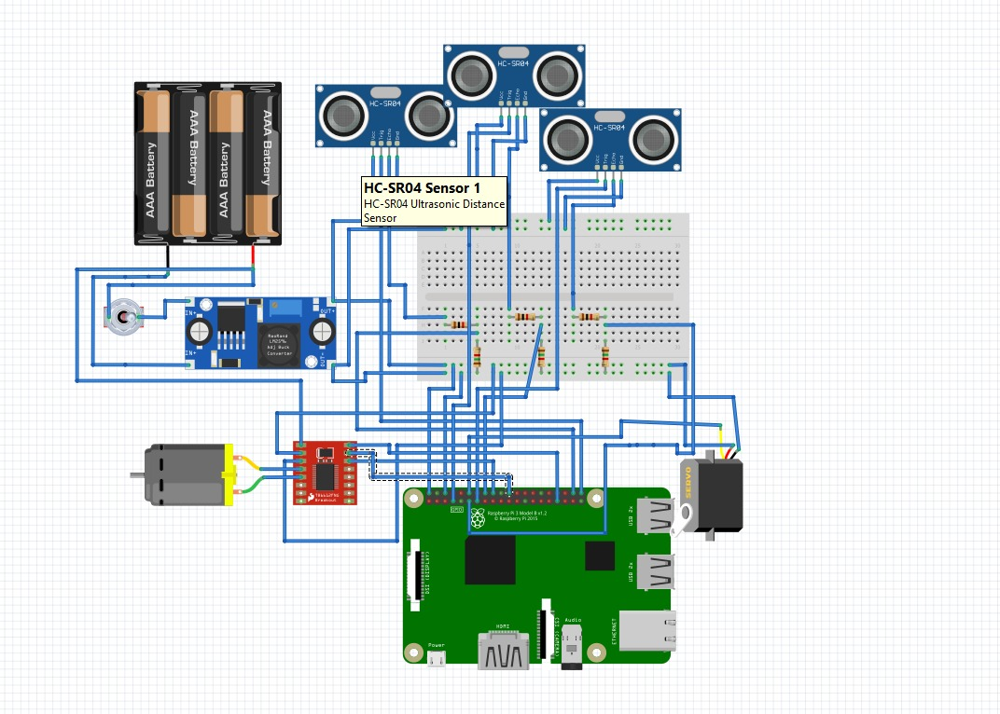

# Wiring diagrams

| File | Description |
|------|-------------|
| `wiring-diagram.jpg` | Full wiring diagram: Raspberry Pi, TB6612FNG, servo, 3 × HC-SR04 with voltage dividers, LM2596 buck converter, battery |
| `layout-sketch.jpg` | Hand-drawn component layout on the chassis (13.6 × 26 cm) and power distribution plan |
| `pin-planning-whiteboard.jpg` | GPIO pin planning on the whiteboard |
| `wiring-diagram-with-camera.jpg` | Same wiring, with the Pi Camera on the CSI port |
| `schematic-view.png` | Fritzing schematic view of the same circuit |

> **Why the colour sensor is missing from the diagrams:** Fritzing has no part for the TCS3200, so it could not be drawn. It is fully wired on the real robot (pins below) and is used to count laps. The AAA battery holder in the drawings is a placeholder for our 2 × 18650 Li-ion pack.

## Pin table

| Function | Signal | GPIO (BCM) |
|----------|--------|-----------|
| Steering servo | PWM | 18 |
| TB6612 motor driver | PWMA / AIN1 / AIN2 | 13 / 24 / 25 |
| Ultrasonic right | TRIG / ECHO | 21 / 20 |
| Ultrasonic front | TRIG / ECHO | 27 / 17 |
| Ultrasonic left | TRIG / ECHO | 4 / 23 |
| TCS3200 colour sensor | S0 / S1 / S2 / S3 / OUT | 22 / 10 / 9 / 11 / 8 |
